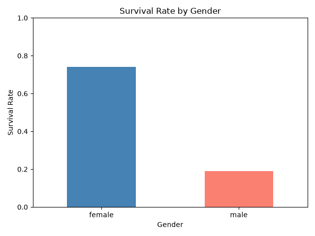
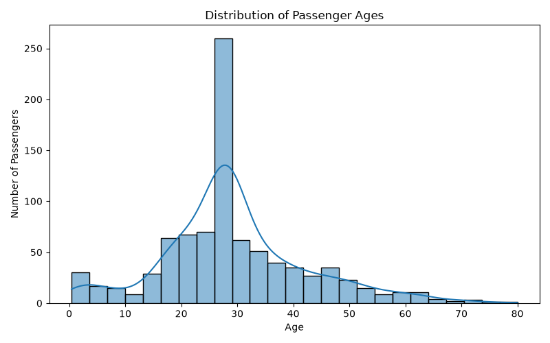
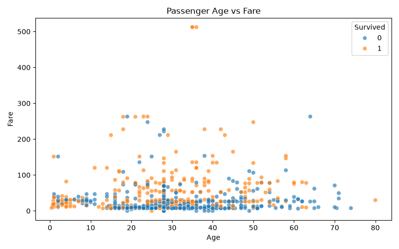
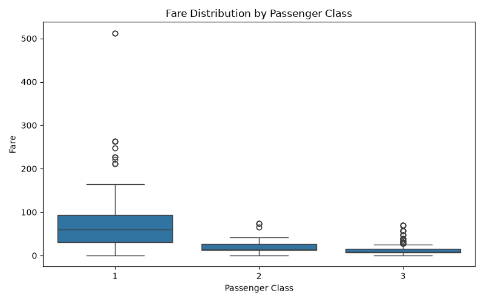

# Titanic Exploratory Data Analysis

An introductory data-analysis project that explores passenger demographics,
ticket fares, passenger class, and survival outcomes from the classic Titanic
dataset.



## Project overview

This project uses Python, Pandas, Matplotlib, and Seaborn to:

- inspect the Titanic training dataset;
- identify missing values and basic data-quality issues;
- prepare a cleaned analysis dataset;
- compare survival rates by gender and passenger class;
- examine the passenger age distribution;
- explore the relationship between age and fare;
- identify fare patterns and potential outliers across passenger classes.

The main analysis is contained in [`day06_titanic.py`](day06_titanic.py).

## Dataset

The project uses `train.csv`, the standard Titanic training dataset.

| Detail | Value |
| --- | ---: |
| Passengers | 891 |
| Columns in the source data | 12 |
| Overall survival rate | 38.38% |
| Missing ages | 177 |
| Missing cabins | 687 |
| Missing embarkation ports | 2 |

The cleaned data is saved in [`clean_df.csv`](clean_df.csv). During cleaning:

1. Missing `Age` values are replaced with the median age.
2. Missing `Embarked` values are replaced with the most frequent port.
3. `Cabin` is removed because most of its values are missing.

## Key findings

### Survival differed substantially by gender

| Gender | Survival rate |
| --- | ---: |
| Female | 74.20% |
| Male | 18.89% |

The gender comparison is visualized in [`my_plot.png`](my_plot.png).

### First-class passengers had the highest survival rate

| Passenger class | Survival rate |
| --- | ---: |
| 1st | 62.96% |
| 2nd | 47.28% |
| 3rd | 24.24% |

This indicates a strong relationship between passenger class and survival in
this dataset.

### Age and fare have only a weak linear relationship

The correlation between `Age` and `Fare` is approximately **0.096**, suggesting
that age alone is not a strong linear predictor of fare. The scatter plot also
shows that fare values vary widely, including several high-fare observations.

## Visualizations

### Passenger age distribution



### Passenger age versus fare



### Fare distribution by passenger class



## Tech stack

- Python 3
- [Pandas](https://pandas.pydata.org/)
- [NumPy](https://numpy.org/)
- [Matplotlib](https://matplotlib.org/)
- [Seaborn](https://seaborn.pydata.org/)

## Getting started

### 1. Clone the repository

```bash
git clone <repository-url>
cd titanic-project
```

### 2. Create and activate a virtual environment

Linux/macOS:

```bash
python3 -m venv titanic-env
source titanic-env/bin/activate
```

Windows PowerShell:

```powershell
python -m venv titanic-env
.\titanic-env\Scripts\Activate.ps1
```

### 3. Install dependencies

```bash
python -m pip install numpy pandas matplotlib seaborn
```

### 4. Run the analysis

```bash
python day06_titanic.py
```

The script prints dataset summaries and analysis results, and generates the
following plot files in the project directory:

- `my_plot.png` — survival rate by gender
- `Age_plot.png` — passenger age distribution
- `age_fare.png` — age versus fare
- `fare_distribution.png` — fare distribution by passenger class

## Project structure

```text
.
├── day06_titanic.py       # Data loading, cleaning, analysis, and plots
├── train.csv              # Original Titanic training data
├── clean_df.csv           # Cleaned analysis data
├── my_plot.png            # Survival by gender
├── Age_plot.png           # Age distribution
├── age_fare.png           # Age versus fare
├── fare_distribution.png  # Fare by passenger class
└── README.md              # Project documentation
```

## Notes

This is an exploratory analysis project, not a production survival-prediction
model. The results describe patterns in the supplied training data and should
not be interpreted as causal conclusions.
